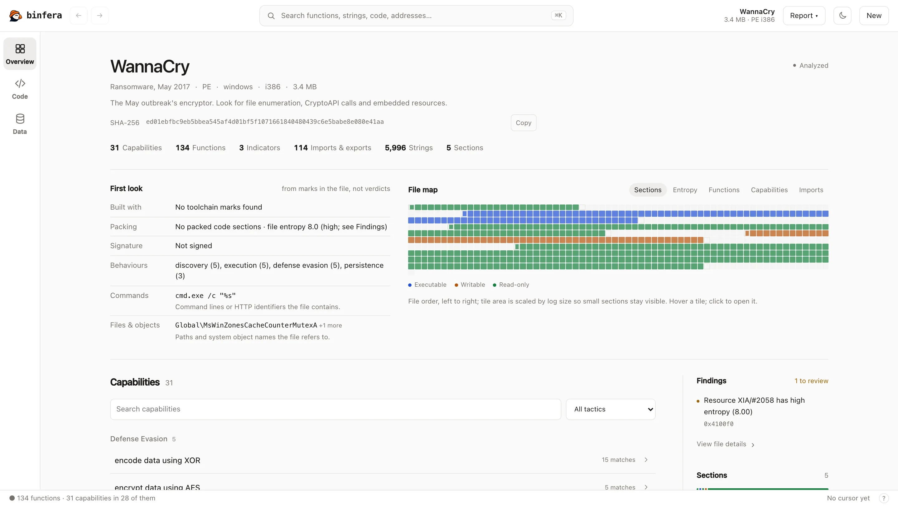
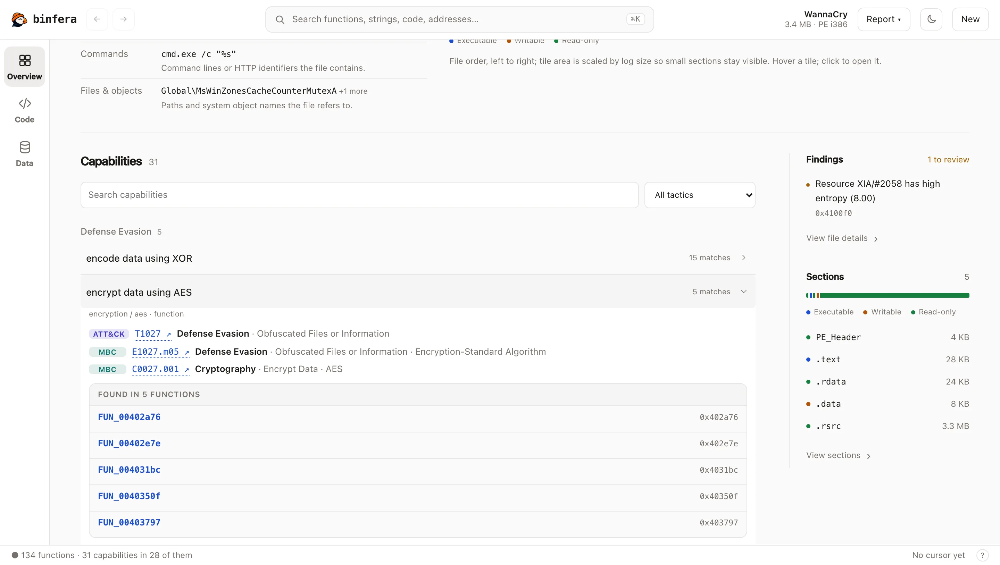
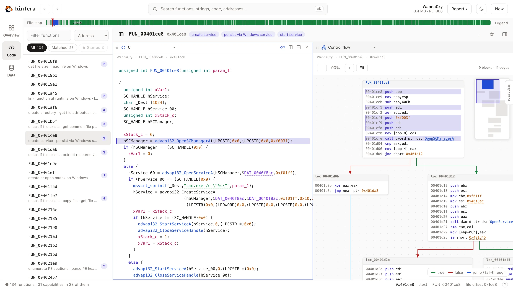
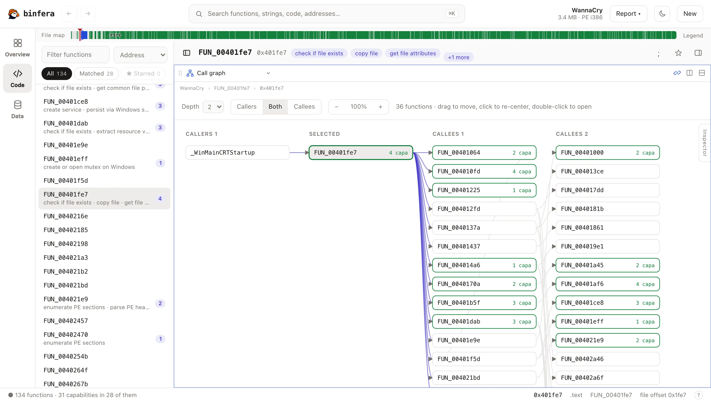
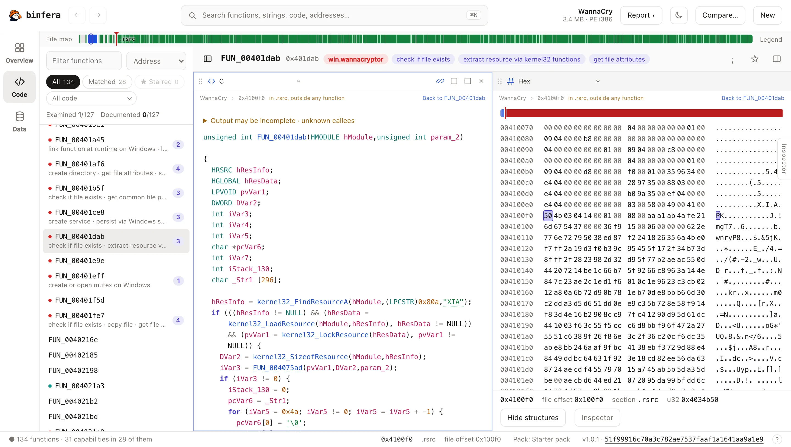
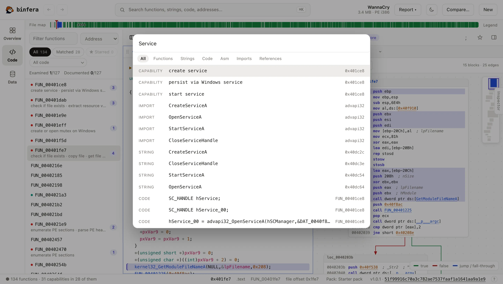
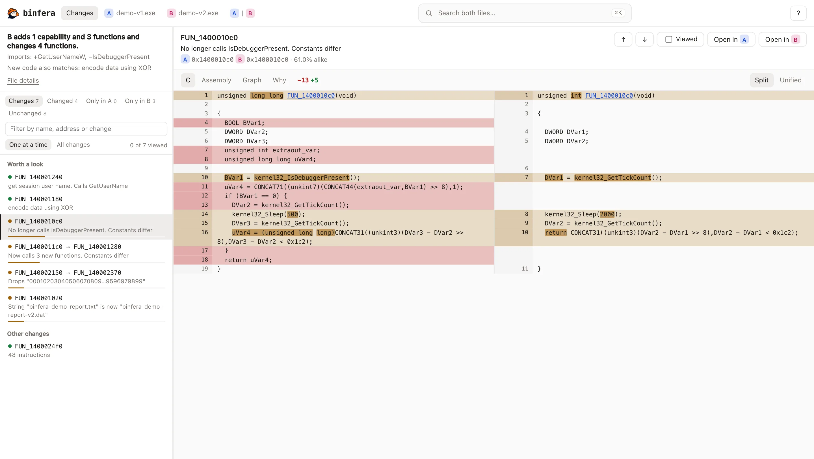
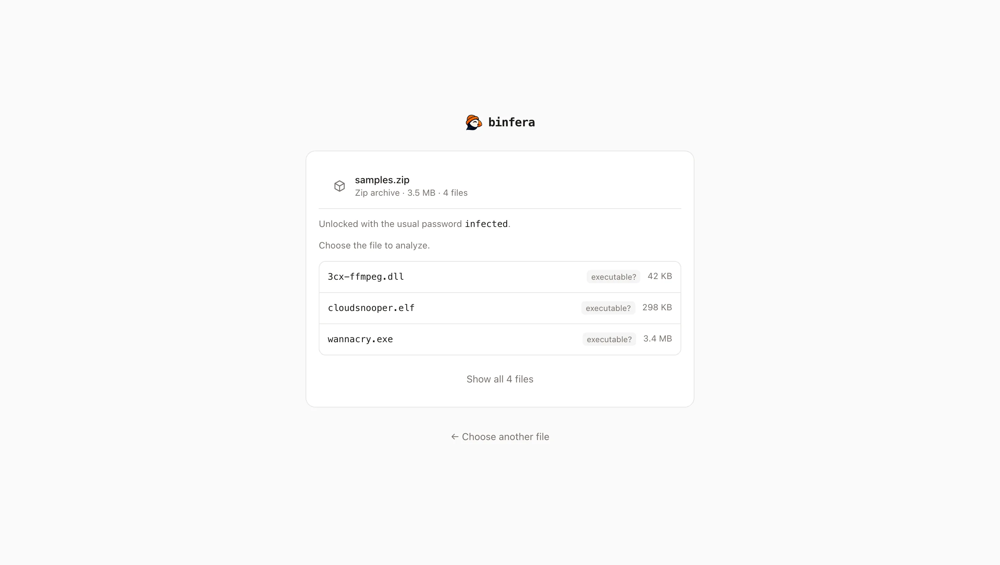
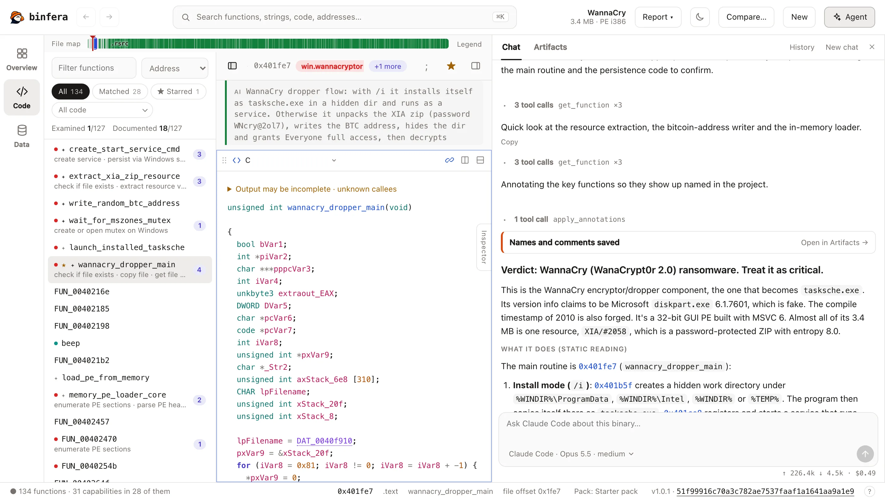
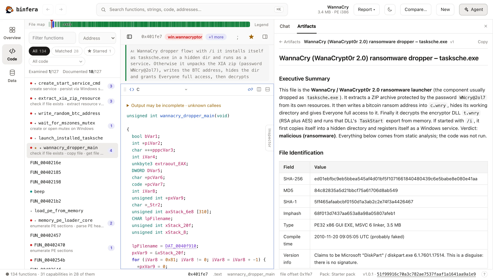

<p align="center">
  
</p>

**See what a binary does.** Decompiled C, capabilities mapped onto the code, and diffs for Windows, Linux and macOS executables. Use it in a browser, as a desktop app, or from your AI agent and the command line. Analysis runs on your machine.


binfera pairs a Rust analysis engine with an embedded native decompiler (Ghidra's C++ core and SLEIGH, no JVM). The browser build runs both as WebAssembly in Web Workers, so a sample never leaves the page and there is no backend. Capability matches come from a native Rust implementation of [Mandiant capa](https://github.com/mandiant/capa) that runs the unmodified capa rules.

[Try it in your browser](https://binfera.io) · [Documentation](https://docs.binfera.io) · [Releases](https://github.com/Karib0u/binfera/releases)

> Status: early release (1.0). Expect rough edges; interfaces may still change.

## Choose how to use it

| I want to… | Use | Start |
|---|---|---|
| Try it now, with nothing to install | Browser | [1](#1-in-a-browser) |
| Analyze files day to day and keep my notes | Desktop app | [2](#2-desktop-app) |
| Let Claude Code or Codex do the analysis | Desktop app, or command line and MCP | [2](#2-desktop-app), [3](#3-ai-agent-without-the-desktop-app) |
| Check builds in a script or CI | Command line | [4](#4-in-a-script-or-ci) |

## What it does

- **Decompiled C for every function.** x86, x86-64 and AArch64 in PE, ELF and supported Mach-O images, plus ARM32/Thumb (PE, ELF) and classic MIPS32 (ELF). See the [supported scope](docs/decompiler.md).
- **Capabilities on the code.** capa rule matches, with ATT&CK ids, mapped onto the functions that triggered them.
- **Compare two binaries.** Which capabilities, functions and file contents changed, down to the instruction. See [comparing binaries](docs/comparison.md).
- **Read it your way.** Control-flow graph, assembly, strings, imports and sections; FLIRT signatures and Function ID packs name library code.
- **Keep your work.** The desktop app saves your renames and comments and remembers the files you opened.
- **Bring your own AI agent.** An [MCP server](docs/mcp.md) lets Claude Code, Codex or any MCP client name functions, comment code and save reports with evidence. binfera runs no model, and every agent run can be undone.
- **Local by design.** Nothing is uploaded; the static site can be served from any host.

## A closer look

Every picture is the WannaCry demo from [binfera.io](https://binfera.io), so you can open it and follow along. The [tour](https://docs.binfera.io/tour/) walks through each view.

<table>
  <tr>
    <td width="50%"><a href="docs/images/overview.webp"></a><br><b>Overview.</b> What the file is, how it was built and packed, and its capabilities by ATT&CK tactic.</td>
    <td width="50%"><a href="docs/images/capabilities.webp"></a><br><b>Capabilities on the code.</b> ATT&CK and MBC ids, and the functions behind each match.</td>
  </tr>
  <tr>
    <td><picture><source media="(prefers-color-scheme: dark)" srcset="docs/images/code-dark.webp"></picture><br><b>Decompiled C and the graph.</b> C, assembly, listing, graphs, hex, strings and imports, side by side.</td>
    <td><a href="docs/images/callgraph.webp"></a><br><b>Call graph.</b> Callers and callees, with the capabilities each one carries.</td>
  </tr>
  <tr>
    <td><a href="docs/images/hex.webp"></a><br><b>Code and bytes.</b> The function that loads a resource, beside the ZIP it extracts.</td>
    <td><a href="docs/images/search.webp"></a><br><b>Search everything.</b> Functions, capabilities, imports, strings and code in one list.</td>
  </tr>
  <tr>
    <td><a href="docs/images/compare.webp"></a><br><b>Compare two builds.</b> Every change ranked, down to the changed lines.</td>
    <td><a href="docs/images/archive.webp"></a><br><b>Archives.</b> Zip and 7z open in place, with the usual passwords tried for you.</td>
  </tr>
</table>

### With your own AI agent

In the desktop app, **Agent** runs your own Claude Code or Codex through Binfera's tools. Below is a real Claude Code triage of the same sample: it read the overview and the key functions, named and commented them, and answered with addresses you can click. Then it saved a report with evidence. Every run can be undone.

| The triage, in the Agent panel | The report it saved |
|---|---|
|  |  |

[Watch the run](https://docs.binfera.io/mcp/#binfera-desktop) (20 seconds).

## How it compares

binfera is built for the first hours with an unknown file (what is it, what does it do, what changed), not as a replacement for a full reverse-engineering suite. Next to Ghidra and radare2:

- **Fast discovery.** It is written in Rust, and lists a file's functions a median of 23 times sooner than Ghidra's headless analyzer, across PE, ELF and Mach-O on x86, x64, ARM and MIPS ([measurements and caveats](docs/benchmarks.md)). The decompiler core is Ghidra's own, so decompiled output is the same kind of work; the gain is in discovery.
- **Capabilities on the code.** Every function carries the behaviours it implements, with ATT&CK ids.
- **Nothing to install, nothing uploaded.** It runs in a browser tab, and the command-line tool is one file.
- **Built for AI agents.** An MCP server with saved notes, undoable runs and reports whose evidence is checked.
- **Compare built in.** Two builds, down to the instruction.

It has no debugger, no plugin or scripting ecosystem, fewer architectures and file formats than Ghidra or radare2, no type or prototype editing and no patching. Use it alongside them, not instead.

## Getting started

Download from [Releases](https://github.com/Karib0u/binfera/releases). Pick the path that fits: they share the same engine, and the desktop app and an AI agent share the same notes.

### 1. In a browser

Open [Binfera in your browser](https://binfera.io), pick a sample or drop a file. Nothing is uploaded.

### 2. Desktop app

Download the installer for your OS from the [latest release](https://github.com/Karib0u/binfera/releases/latest) and run it. The macOS app is signed and notarised; the Windows installer is not signed, so SmartScreen warns on first run ([details](https://docs.binfera.io/installation/#code-signing)).

1. **Choose a file** or drop one on the window. Recent files and your renames and comments are kept.
2. To bring in an AI agent, click **Agent** (Cmd/Ctrl+J). The app runs your own Claude Code or Codex against the open file; pick a request such as **Triage this binary** or ask your own.

### 3. AI agent without the desktop app

For Claude Code, Codex or any MCP client, with nothing but the command-line tool.

1. Install `binfera`. It is one file and includes the capa rules:

   ```sh
   curl -fsSL https://binfera.io/install.sh | sh   # macOS, Linux
   irm https://binfera.io/install.ps1 | iex       # Windows, PowerShell
   ```

   Or download the archive for your platform from Releases and unpack it. The scripts check the download against the release's `SHA256SUMS` and install to `~/.binfera/bin` (`%LOCALAPPDATA%\binfera\bin` on Windows).
2. Register it with your agent, using the full path to the binary:

   ```sh
   claude mcp add --scope user binfera -- ~/.binfera/bin/binfera mcp
   codex mcp add binfera -- ~/.binfera/bin/binfera mcp
   ```

3. Ask: *"Open `sample.exe` with Binfera and write a full analysis report."*

Everything the agent saves is kept in a local project database, and the desktop app opens the same one, so you can review an agent's work there later. See [Binfera MCP server](docs/mcp.md) for the tools and limits, and [function emulation](docs/emulation.md).

### 4. In a script or CI


```sh
binfera sample.exe -j -q | jq -r '.rules | keys[]'   # capabilities, one per line
binfera diff old.exe new.exe                         # exits 1 when the builds differ
```

JSON output, exit statuses, baselines and the rest are in the [command-line guide](docs/cli.md).

## Build from source

You need Rust, a C++ toolchain and git.

```sh
git clone https://github.com/Karib0u/binfera.git
cd binfera
git submodule update --init rules                # the capa rules (Ghidra's sources are vendored)
```

**Command line** (add `--features decompiler` for decompiled code; Rust 1.89+ and a C++ compiler: zlib on macOS and Linux, Visual Studio Build Tools on Windows):

```sh
cargo build --release -p binfera-cli --features decompiler
target/release/binfera sample.exe                 # capabilities
target/release/binfera sample.exe --decompile-all # every function as C, one JSON object per line
target/release/binfera sample.exe --emulate 0x140001000 --emulate-arg 42 # isolated function emulation
claude mcp add --scope user binfera -- "$PWD/target/release/binfera" mcp   # or: codex mcp add binfera -- ...
```

With the rules submodule present, the build embeds the rules in the binary, so it runs from any folder; to use your own, pass `-r` or set `BINFERA_RULES_DIR`. See [Binfera MCP server](docs/mcp.md) and [`docs/decompiler.md`](docs/decompiler.md) for the decompiler's scope and limits ([`docs/decompiler-design.md`](docs/decompiler-design.md) for its API).

**Web app.** One-time toolchain setup (macOS):

```sh
brew install emscripten
rustup target add wasm32-unknown-emscripten
```

Then from `web/`:

```sh
npm install
npm run prepare-assets   # build the wasm module and bundle the rules
npm run dev              # http://localhost:5173
npm run build            # static site in dist/
```

Details in [`web/README.md`](web/README.md).

**Desktop app.** From `web/`:

```sh
npm install
npm run prepare-desktop  # the native engine and the capa rules, bundled with the app
npx tauri build          # installers under src-tauri/target/release/bundle/
```

## Contributing

| Path | What |
|---|---|
| [`web/`](web/) | The browser app (Vite + React + TypeScript), workers and wasm glue; [`web/src-tauri/`](web/src-tauri/) is the desktop app |
| [`binfera/`](binfera/) | Core Rust engine: loaders, recovery, feature extraction, rule matching, decompiler bindings |
| [`binfera-cli/`](binfera-cli/) | CLI, also the entry point compiled to wasm |
| [`binfera-mcp/`](binfera-mcp/), [`binfera-project/`](binfera-project/) | The MCP server and the project database it shares with the desktop app |
| [`third_party/`](third_party/) | Vendored Ghidra decompiler and SLEIGH sources |
| [`binfera-python/`](binfera-python/), [`binfera-ghidra/`](binfera-ghidra/) | Python bindings and the Ghidra decompiler bridge |
| [`docs/`](docs/) | Architecture, decompiler, CLI, MCP and compatibility docs |

```sh
cargo test --workspace
```

[`docs/development.md`](docs/development.md) covers setup, the parity test loops and the full checks.

## License

Apache License 2.0, see [LICENSE](LICENSE) and [NOTICE](NOTICE). Includes code derived from Ghidra (Apache 2.0) and runs Mandiant's capa rules. binfera is independent and not affiliated with or endorsed by Google LLC, Mandiant, Inc. or the NSA.
