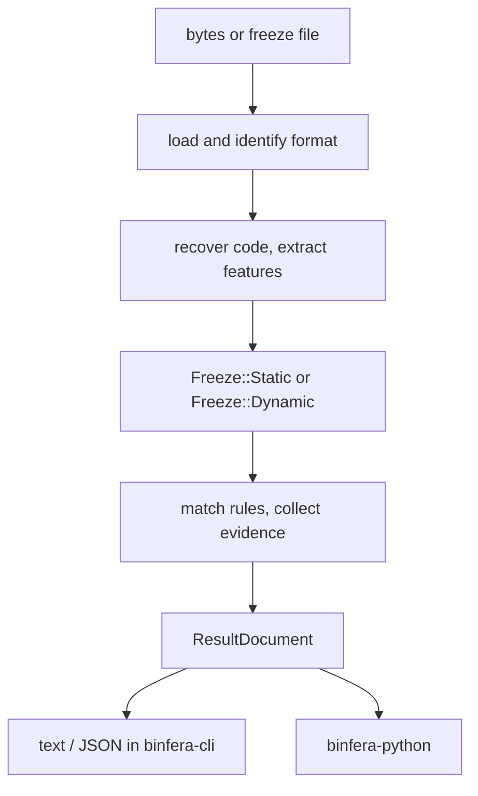
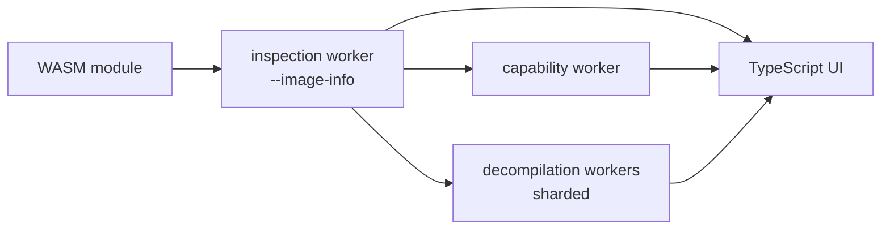

# Architecture

One Rust library does the analysis. Everything else is a front end over it: a CLI, an MCP server, Python bindings, and a browser and desktop workbench that runs the CLI as WebAssembly.

| Layer | Owns |
|---|---|
| `binfera` (library) | Input handling, code recovery, feature extraction, rule matching, decompilation policy, diff |
| `binfera-cli` | Arguments and serialization |
| `binfera-ghidra` | The only FFI crate: the native decompiler bridge |
| `binfera-mcp`, `binfera-project` | MCP server and the project database it shares with the desktop app |
| `binfera-python` | PyO3 declarations only, no analysis logic |
| `web/` | Workers, navigation and views in TypeScript; Tauri shell for desktop |

## Workspace

```text
binfera/
├── binfera/                    analysis library
│   ├── rules/                  rule grammar, validation, dependency graph
│   ├── extract/loader/image/   PE, ELF and Mach-O loaders and decoding
│   ├── extract/recovery/engine/ seed discovery, flow traversal, function views
│   ├── extract/features/       feature extraction over recovered code
│   ├── image_info/             headers, sections, imports, exports, file mappings
│   ├── decompiler/batch/       whole-image selection, typed events, graphs
│   ├── freeze.rs               capa freeze format reader and model
│   ├── capabilities/           static and dynamic rule matching
│   ├── result_document/        canonical result model
│   ├── diff/                   fingerprints, function matching, diff document
│   └── render/                 text and JSON renderers
├── binfera-cli/                command line
├── binfera-ghidra/             optional native decompiler bridge
├── binfera-mcp/                MCP server (`binfera mcp`)
├── binfera-project/            project database
├── binfera-python/             Python bindings
├── web/src-tauri/              desktop shell (Tauri)
├── web/src/engine/             worker protocol and assets
├── web/src/workspace/          navigation, ownership, reference indexes
├── web/src/views/              capability, function, string, section views
├── third_party/dnfile/         vendored CLR metadata and CIL parser
├── rules/                      pinned capa-rules submodule
├── reference/capa/             pinned Python capa, the behavioral reference
└── scripts/                    differential tests, benchmarks, maintenance
```

`third_party/dnfile` is a path dependency of `binfera`, kept outside the workspace so its optional command-line targets aren't built.

## Data flow



The entry point is `binfera::api::analyze(bytes, &MatchingRuleSet, AnalysisOptions) -> ResultDocument`. `load_input` is public too, for callers that need the freeze data before matching. Reading files and rules, argument parsing and presentation stay at the edges.

## The freeze seam

Extraction and matching meet at `binfera::freeze::Freeze`. A backend turns bytes into a static or dynamic feature tree; the matcher consumes it without knowing whether it came from PE, ELF, shellcode, .NET, Mach-O or a freeze file.

This keeps two kinds of correctness independent:

- **Extractor tests** compare recovered features with an upstream or native oracle, without rules.
- **Engine tests** check parsing, evaluation, scopes and evidence from freeze fixtures, without a binary.

**Order is part of the contract.** Feature collections keep the order capa's short-circuiting string and regex evaluation depends on; address-keyed scopes are traversed in address order.

## Backends

Every backend does the same job: validate its container, recover code, emit capa-shaped features, hand the tree to the shared matcher. Adding one changes format dispatch and extraction, not the rule engine, result schema or renderers.

| Backend | Path |
|---|---|
| PE, ELF x86/x64 | Format loader → shared recovery → x86 decoder and feature modules. FLIRT naming is an optional PE step. |
| Raw shellcode | Explicit architecture, then the shared recovery and x86 pipeline with no container loader. |
| .NET | Managed PE validated, metadata and CIL from the vendored `dnfile`. |
| Mach-O | Thin or fat validation and slice selection; x86_64 uses the x86 path, arm64 the AArch64 one. |
| AArch64 ELF, PE | Format-specific loading and relocations, then AArch64 recovery and features. |
| Freeze file | Skips extraction and enters at matching. |

### Two recoveries

PE and ELF x86/x64 code is recovered two ways, for two goals.

| | Compatibility recovery | Native recovery |
|---|---|---|
| **Goal** | Match Python capa exactly | Find the real functions for decompilation |
| **Used by** | Capability analysis | Decompiler, diff, workbench graphs |
| **Decoding** | Follows the pinned reference decoder, including legacy `BOUND` and ModRM aliases | Modern decoding |
| **Function starts** | Registered entry signatures | Adds `.pdata`, unwind tables, code named by data, tail jumps, prologue and call scans |
| **Switch tables** | Stop at the first definite evaluation failure, in table order | Complete guarded switches |
| **ELF relocations** | Only the reference's import relocation types | Broader bindings |
| **Blocks** | Keep overlapping reference blocks apart from their instruction streams | — |

??? info "Compatibility recovery details"
    Undefined pointer and operand-reference targets are evaluated by a bounded abstract interpreter over iced-x86, before late signature scans. It tracks private state without running the sample; unsupported paths keep diagnostics. Windows callback recovery reuses this state for typed API arguments. Import-call fragments run before entry signatures and keep each callee's instruction view at creation, so later loose instructions don't change function ownership.

    Full PE analysis uses workspace segment names; file-only analysis uses pefile section names. File-only PE and ELF format features have file scope.

### Shared state

Bundled FLIRT signatures are parsed once per process and shared immutably. The first caller's job count sets initialization; later calls reuse the databases, which stay in memory until exit. Custom signature paths are reloaded on every call so edits and errors stay visible.

## Decompiler

The `decompiler` feature returns a separate `Decompilation`. Recovery supplies discovery metadata, SLEIGH translates the bytes and Ghidra decompiles. Capability analysis never starts the engine. Details: [Decompiler](decompiler.md) and [Decompiler design](decompiler-design.md).

`decompiler::decompile_all(bytes, options, emit)` streams typed `BatchEvent`s. The library reconciles the two function inventories, selects shards, finds supporting callees, and handles session rebuilds and resource retries; a callback error stops the batch. The CLI only serializes these events as NDJSON. Managed assemblies produce IL listings; ELF CPUs without a decoder produce file-wide diagnostics through the same API.

Function events carry basic blocks, edges, direct calls and data references, so the browser draws graphs without re-decoding assembly. Listings without a full graph (IL, some extra callees) fall back to the listing. Layout and presentation stay in TypeScript.

## Binary comparison

`diff::fingerprint` reduces a binary to a `Fingerprint`, from native recovery or, for managed code and freeze files, from features. `diff::compare` takes two fingerprints and optionally two `ResultDocument`s and never sees the samples, so the browser fingerprints each side in its own worker and compares in a third. See [Compare two binaries](comparison.md).

## Browser



The browser first runs `--image-info` in a short-lived worker. It returns pointer width, byte order, entry point, sections, imports, exports, file details and the Function ID pack to load. TypeScript wraps those mappings for navigation and scans display strings against them; it has no PE, ELF or Mach-O parser of its own. Capability and decompilation workers then run independently, within the memory limits and shard policy.

### Image metadata

`image_info::inspect(bytes, arch)` reads metadata without recovery, signatures or rules, using the recovery loaders' mappings and slice selection. Offsets refer to the original input, universal containers included.

`image_info::details` adds what an analyst reads before the code: every header field at its offset and address, hashes, hardening, dependencies, build traces, findings, the overlay, PE resources and version info, and Authenticode and Apple code signatures. It never fails an inspection, and every length and offset read from the file is bounded.

- **Signatures** are checked against the file's digest or page hashes. Certificate chains and trust are not evaluated: a match means the file is intact, not that the signer is trustworthy.
- **Imphash** follows pefile, ordinal names included, so values compare with other tools.
- **Overlay** excludes debug data and COFF symbol tables, which pefile counts.
