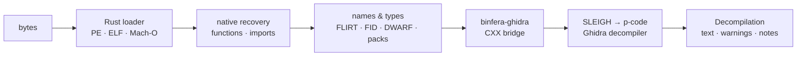

# Decompiler design

How the embedded decompiler is put together, for contributors. What it supports is on [Decompiler](decompiler.md).

## Principles

- **Ghidra decides the C.** p-code semantics, data flow, structuring and printing stay in Ghidra's C++ core. Binfera never translates instructions to p-code itself.
- **Binfera supplies the facts.** Loading, function discovery, names, prototypes and types come from Rust, and are copied into the native session.
- **Gaps are visible.** Anything inferred or unknown becomes a warning and sets `incomplete`. Machine code stays the authority.
- **Output doesn't depend on order.** The same function decompiles the same way whichever requests came before it.
- **Off by default.** Capability analysis never starts the engine. Without the `decompiler` feature no C++ is compiled.



## Boundary and ownership

`binfera-ghidra` is the only FFI crate. Its [CXX](https://cxx.rs) declarations are the unsafe boundary; the Rust side owns the native session and passes copied slices and strings. `binfera` and `binfera-cli` keep `#![forbid(unsafe_code)]`. CXX is pinned at 1.0.180. It generates ownership and exception glue, but does not make the native parser memory safe.

Ghidra sources and specifications are vendored and pinned together with their notices and checksums ([PINNED.md](https://github.com/Karib0u/binfera/blob/main/PINNED.md), [vendoring notes](https://github.com/Karib0u/binfera/blob/main/third_party/ghidra/README.md)). SLEIGH specs are compiled at build time by a native SLEIGH compiler built from the same source, and embedded. Builds are native only; a cross build fails with an explicit error. The browser build targets `wasm32-unknown-emscripten`.

| Requirement | macOS, Linux | Windows |
|---|---|---|
| Compiler | C++14 | MSVC (C++17) |
| zlib | system headers and library | built from source |

## Sessions and concurrency

A `DecompilerSession` owns one loaded image. Specifications are initialized once per session; function analysis is cleared after every request.

- **Not `Send` or `Sync`.** A process-wide C++ mutex serializes initialization, every native call and destruction, because Ghidra keeps global registries. Sessions on separate threads exist side by side but never run at once. Don't remove this lock without a new upstream audit.
- **Own translator.** Upstream `SleighArchitecture` keeps a static mutable translator map; the adapter bypasses it and owns its translator.
- **Parallelism is by process.** `--decompile-all --jobs N` starts up to 16 worker processes. The browser shards the same way across workers (`--shard INDEX/COUNT`).
- **Failure.** An unexpected native error poisons the session; create another. A time or work limit aborts only its request. Requests Rust rejects leave the session usable.

```rust
use binfera::decompiler::{DecompilerSession, ResourceLimits, ValueType};

let mut session = DecompilerSession::from_pe(&bytes)?;      // or from_elf, from_macho, from_bytes
session.set_limits(ResourceLimits::default())?;
session.set_signature(0x140001000, ValueType::I32, &[ValueType::I32])?;  // optional
let f = session.decompile_function(0x140001000)?;
println!("{}", f.text);
```

| Constructor | Use |
|---|---|
| `from_bytes` | Picks the format by magic. |
| `from_pe`, `from_elf`, `from_macho(bytes, arch)` | Runs recovery, library matching and naming once. |
| `from_shellcode_with_analysis(bytes, convention)` | Raw code mapped at zero. |
| `from_analysis(&analysis, &names, convention)` | Reuses existing recovery and a caller's symbol map. Applies no library names or effect models. |

The Rust result always carries timings; the CLI drops them unless `--timing` so its JSON is deterministic.

## Request pipeline

What happens for one `decompile_function`:

1. **Register** the entry if recovery missed it. Direct tail calls and IAT jump thunks get Ghidra's `CALL_RETURN` flow override.
2. **Infer callee prototypes** for up to 16 unknown direct callees, 16 analyzed functions below each, four call levels deep. Only clean analyses (no gaps, no unknown callees) contribute.
3. **Analyze** the function.
4. **Name data**: find the data addresses it touches, add Ghidra-style symbols, analyze again.
5. **Print**, collect warnings and notes, then release every request-local symbol, lock and override.

Each phase gets the full time and work budget. Inference has its own budget; if it runs out the function is decompiled without it and carries an "inference skipped" warning.

??? info "Inference cache"
    Inferred signatures are cached per session as a pure function of the image and the explicit signatures. A cache hit charges the work of the original computation, so output and limits don't depend on request order. `set_signature` and the other mutators drop the cache. Only proven context-independent scalar leaf inferences survive into the next request; the rest can depend on that request's data symbols and are evicted (counted as `request context`).

??? info "Return-type and convention heuristics"
    - **Void retry.** When a recovered caller reads the return register before overwriting it, an inferred `void` result is retried as an unknown integer of the observed width. On x64, disagreeing or byte-only observations and jump thunks don't select a width. On x86, only closed leaf functions that write `EAX` and not `EDX` qualify.
    - **Import passthrough.** A straight-line wrapper that returns an imported call unchanged can take the import's four-byte return.
    - **x86 `__cdecl`.** Recursive calls with matching pushes, caller cleanup and non-purging returns can select `__cdecl` for that request.
    - **Win64 home slots.** Stores into all four register home slots corroborate four integer inputs, even with unknown callees. A stub that homes but never uses them can't erase its callers' arguments.
    - **Boolean.** On x86-64, a caller's `AL` use can confirm a Boolean return when every return path has a Boolean low byte. A cast of a constant above one to `bool` adds a warning.
    - **Variadic forwarders.** A validated GCC SysV register-save prologue and `va_list` layout fix the fixed argument count.

    All are request-local, reported as inferences, and never override an explicit or archive signature.

## Function discovery

Decompilation uses **native recovery**, which adds sources the capa-compatible recovery does not. Capability results are unaffected: everything below is gated on `RecoveryBackend::Native`.

| Source | Rule |
|---|---|
| `.pdata` | Every non-chained `RUNTIME_FUNCTION` is a start and bounds its function exactly. Reading continues past an unreadable entry. |
| Code named by data | `u32`/`u64` values in non-code sections (`.rdata`, `.xdata`) that name undecoded code following a function end. Finds MSVC funclets. |
| RIP-relative `lea` | Callbacks referenced only by address, with the same boundary checks. |
| Tail jumps | A direct `jmp` to code right after a function end and padding. A `jmp [import]` stub that other code branches to. |
| `.eh_frame` | FDE starts for x86, x64 and AArch64, with a `PT_GNU_EH_FRAME` fallback. |
| `.ARM.exidx` | ARM EHABI entries, including stripped leaves. |
| Go `pclntab` | Every entry is a function; starts strictly inside one are dropped. |
| DWARF, COFF symbols | Subprograms and function symbols. COFF names beat signature names; Go and exports beat COFF. |
| Mach-O | `LC_FUNCTION_STARTS`, exports, Objective-C and Swift metadata. |
| Prologues | A bounded set of GCC, Windows and Delphi patterns after padding or returns. |

The Vivisect `/GS` cookie-tail split is skipped: Ghidra keeps the check in its caller.

??? info "Batch enumeration and jump tables"
    `--decompile-all` reconciles the compatibility and native inventories. It drops compatibility-only literals, relative-offset tables and internal labels only with native data or flow evidence; uncertain candidates stay. ELF unwind entries are always included. A resource-limited function is retried once at 60 s per phase, 100,000 instructions and 200,000,000 work units, at most 16 times per image, recorded as `resource_retry`.

    ELF unwind ranges also bound speculative jump tables: a target inside another declared function stops enumeration. A shortened table stays marked incomplete.

**Not done:** a stack-balance check for the tail-jump rule, full Ghidra start-pattern coverage, and `jmp [import]` stubs nothing references.

## Batch stream

`decompile_all` streams the events the CLI prints as NDJSON ([order and fields](cli.md#decompilation-stream)).

- **Retries.** `BatchOptions.retry` takes `RetryPolicy::{Deferred, Skip, Only(Vec<u64>)}`; `BatchOptions.limits` can tighten the ordinary-attempt budget. Native workers select the retry stage with the hidden, repeatable `--decompile-retry ADDRESS`.
- **Names before bodies.** `start.names` announces supplied function names. A resource-limited attempt keeps its assembly, calls, references and name, with `retry_pending: true`; a later record for the same address replaces it.
- **Consumers.** Python's `decompile_all` passes `names`, `retry_pending`, `settled` and replacement records through. The MCP index keeps the last record per address, including its file offset and updated references, and falls back to inventory names when a record has none. Cached streams without these fields stay readable.

## Names

Explicit names and DWARF override library matches. The Go table and exports beat COFF symbols, COFF beats FLIRT, and exports and FLIRT keep their names over Function ID. Anything left is `FUN_<addr>`.

- **FLIRT.** `from_pe` matches a compact runtime subset (54 patterns, 6 KiB) generated from the pinned Mandiant database, shared process-wide.
- **Function ID.** Every function is hashed the way Ghidra's Function ID analyzer does and looked up in packs built from the Visual Studio databases: `fid-x64.pack` (≈9.9 MB) and `fid-x86.pack` (≈12.6 MB). Matches are scored with caller and callee relations like `FidProgramSeeker`; a name is applied only when unambiguous. Ambiguous matches stay unnamed but still apply a call fixup when every candidate agrees. See [FID.md](https://github.com/Karib0u/binfera/blob/main/binfera/sigs/FID.md).
- **Thunks.** A function that is only `jmp [import slot]` takes the import's name and type.
- **Demangling.** `msvc-demangler` and `cpp_demangle` produce Ghidra's labels (`operator_new`, `Class::vftable`); `rustc-demangle` handles Rust. Microsoft names over 1,024 characters aren't parsed.

## Effect models

Some runtime helpers break calling-convention rules: `__security_check_cookie` preserves RAX, `__chkstk` moves the stack pointer. Ghidra replaces these calls with the `<callfixup>` p-code in the compiler spec; Binfera does the same.

| Spec | Fixups | Names |
|---|---:|---:|
| `x86-64-win.cspec` | 3 | 7 |
| `x86win.cspec` | 10 | 27 |
| `x86gcc.cspec` | PC thunks, retpolines, `__fentry__`, `mcount` | |

`binfera/src/decompiler/effects.rs` maps names to fixups, and a test checks it against the vendored specs. Only names from FLIRT or Function ID select a model; an export is the image's own claim. The output gains Ghidra's `replaced with injection` comment, reported as a note, not a gap.

## Data and string symbols

Ghidra labels data from its program database; the embedded engine has none. So each request derives labels from the image bytes, using Ghidra's conventions:

| Data | Label |
|---|---|
| Global at a constant address | `DAT_<addr>` |
| NUL-terminated ASCII, 4+ chars | `s_<text>_<addr>`, typed `char[n]` |
| NUL-terminated UTF-16LE, 4+ chars | `u_<text>_<addr>` |
| Aligned cell holding an image address | `PTR_FUN_`, `PTR_DAT_`, `PTR_s_`… |

The text is the first 32 characters, with anything but letters, digits, `_`, `<` and `>` replaced by `_`; addresses are padded to the pointer width. These constants were read from Ghidra 12.1.4's output. The 4-character minimum is Binfera's choice.

Go and Rust store strings as pointer and length without terminators. Their sessions keep the label but leave bytes untyped, except Rust strings whose length is read from the binary, which print as literals.

It costs a second analysis of each function that touches data (median request time +26–33%). Request-end cleanup also removes the engine's own `uRam…` placeholders, which otherwise made a global's name depend on earlier requests.

**Limits:** only mapped sections are labeled, so unpacked or zero-filled memory keeps placeholders; globals discovered only during callee inference are named by the engine.

## Types and prototype packs

Ghidra's data type archives (`.gdt`) are exported once to compact packs using Ghidra's own decompiler marshalling, so the engine decodes exactly what Ghidra would send it. Entries are zlib blocks sorted by key; a lookup inflates one block and types resolve on demand through a `TypeFactory` subclass. Nothing is decoded at startup.

| Pack | Size | Contents |
|---|---:|---|
| `winapi64.pack` | 4.1 MB | 43,123 prototypes, 43,667 types (Win32, C library, kernel, Win32 metadata, native API), named values of 1,065 enums and flag sets |
| `winapi32.pack` | 4.1 MB | 42,995 prototypes, 43,603 types, named values of 1,064 sets |
| `sysv64.pack`, `sysv32.pack` | ≈200 KB each | 6,633 prototypes, 1,229 types |
| `macos64.pack` | | 14,256 prototypes (macOS 10.9) |
| `golang64.pack`, `golang32.pack` | 1.7 / 1.6 MB | Go 1.15–1.25 API snapshots by OS and release |

- **Windows imports** are typed only when the module is a known system DLL (`system_import_function`). Ghidra matches by name alone; this stricter policy keeps an unrelated DLL's same-named export untyped.
- **Kernel** prototypes come from MinGW-w64 14.0.0 DDK headers and ReactOS 0.4.15's `fltkernel.h`.
- **Supplements** add fixed loader, stack-protector, Objective-C, CoreFoundation and native Windows calls missing from the archives. Archive declarations win.
- **Go** storage is assigned by a port of Ghidra's `GoParamStorageAllocator`. About 1.3% of amd64 signatures stay unapplied.
- One x86 RAS callback has an unsupported by-value aggregate and stays unknown; a test fails if that count grows.
- **Symbolic constants.** A parameter that the Win32 metadata types as an enumeration or flag set (the pack's `P:<function>` record) gets an enum type named after that set, of the parameter's own size and signedness, when the pack prototype is applied. Ghidra then types the constant arguments with it, and `StringPrintC` spells them from the set's `E:<name>` record: an enumeration prints a member's name only for that exact value (`FILE_END`, never `FILE_CURRENT | FILE_END` for 3, which Ghidra's own enum printing would produce); a flag set also prints an OR of members, in declaration order, when they cover every bit (`MEM_COMMIT | MEM_RESERVE`), and zero stays `0`. A value outside the set, or a bit no member names, stays numeric. `HKEY` constants (`HKEY_LOCAL_MACHINE`) come from the metadata's typed constants and print only for an exact value; `HANDLE` and `HWND` constants are ambiguous (`-1` is also the current-process handle) and are not used. A variable that receives such an argument is declared with the set's name (`PAGE_PROTECTION_FLAGS flProtect`). The pass changes types and printing only, not the p-code.

Regeneration is development-only: [scripts/decompiler_types/README.md](https://github.com/Karib0u/binfera/blob/main/scripts/decompiler_types/README.md).

## Self-contained units

`decompile_unit(&[u64])` builds a C translation unit from 1 to 256 functions, in order: Ghidra's pseudo-types and pseudo-operations, the types and archive prototypes the text names, declarations for everything else, forward declarations, then the bodies. No Python or compiler runs.

| Guess kind | Example |
|---|---|
| `callee_without_prototype` | `extern long long f();` |
| `data_symbol` | `extern` shaped by use: called, indexed, dereferenced |
| `undeclared_global` | same, from the text alone |
| `register_read` | `unaff_*`, `in_*`, `extraout_*` |
| `stack_address` | `stack0x...` |
| `unrecovered_jump` | `UNRECOVERED_JUMPTABLE` |

Sub-piece accesses (`x._0_4_`) are rewritten to byte-range reads and counted in `rewrites`, not guesses. Unknown integer types become unsigned and are listed as `unknown_signedness`. The rule for each construct is in the header of `binfera/src/decompiler/unit.rs`.

## Limits and errors

Defaults are 10 s, 10,000 instructions and 20,000,000 work checkpoints per phase (maximums 60 s, 100,000, 200,000,000). Work is charged for translation, p-code and varnode creation, and rule processing. Mapped bytes, sections, symbols, name lengths and output are bounded too. These are local policy, not upstream defaults.

- **Deadlines are cooperative.** One upstream operation between checkpoints can overshoot. No in-process mechanism can safely kill a stuck C++ thread; a hard boundary would need a separate process.
- **Exceptions are translated** before leaving C++. An exception out of the action tree discards and rebuilds it, because half-run action groups crash the next request.
- **Flow outside executable memory** becomes Ghidra's "bad instruction" warning instead of a failed request.
- **Allocation failure** becomes an error where the C++ runtime throws; process-wide exhaustion is not recoverable.

## Tests

| What | Command |
|---|---|
| PE fixtures | `scripts/build_decompiler_fixtures.sh` (MinGW), then `cargo test --release -p binfera --features decompiler --test decompiler` |
| ARM, Thumb, MIPS | `cargo test -p binfera --features decompiler --test risc` (+ `risc_rel`, `arm_unwind`, `risc_signatures`) |
| Per format and language | `--test decompiler_elf`, `decompiler_elf32`, `decompiler_aarch64`, `decompiler_macho`, `decompiler_go`, `decompiler_rust`, `decompiler_cpp`, `decompiler_delphi`, `decompiler_kernel`, `decompiler_dwarf`, `msvc_eh` |
| Batch and inference cache | `--test decompiler_batch`, `--test decompiler_inference_cache` |
| Browser (RISC) | `cd web && npm run build:wasm && npm run test:risc` |
| Latency | `cargo run --release -p binfera --features decompiler --example decompiler_bench` |

Fixtures are built from source (most directories under `binfera/tests/fixtures` have a `build.sh`), checked in, and only analyzed, never run. The one exception: the floating-point RISC test compiles and runs emitted C from a trusted fixture.

**Reference output.** `tests/decompiler/reference/*.c` comes from Ghidra 12.1.4 headless on the PE fixture DLL (`scripts/decompiler_reference.sh`, development only). Compare control flow, operations, constants and effects, not variable names: Ghidra's full analyzer has more metadata than the embedded adapter.

| Fixture | Logic preserved |
|---|---|
| arithmetic | `x * 7 + y - 3` |
| branches | abs for negative, clamp above 100, else increment |
| loops | sum of squares `0..n-1` |
| switches | seven cases with forwarded arguments |
| stack_variables | two local stores, a masked dynamic index |
| imported_call | `GetTickCount() + arg` |
| nonreturn | `ExitProcess(code)`, no fallthrough |

**Latency.** `decompiler_bench` reports cold session setup and p50/p95/max over 100 requests per function; wrap it in `/usr/bin/time -l` (macOS) or `-v` (Linux) for peak RSS. Rerun it on the commit under evaluation; don't quote old numbers.
