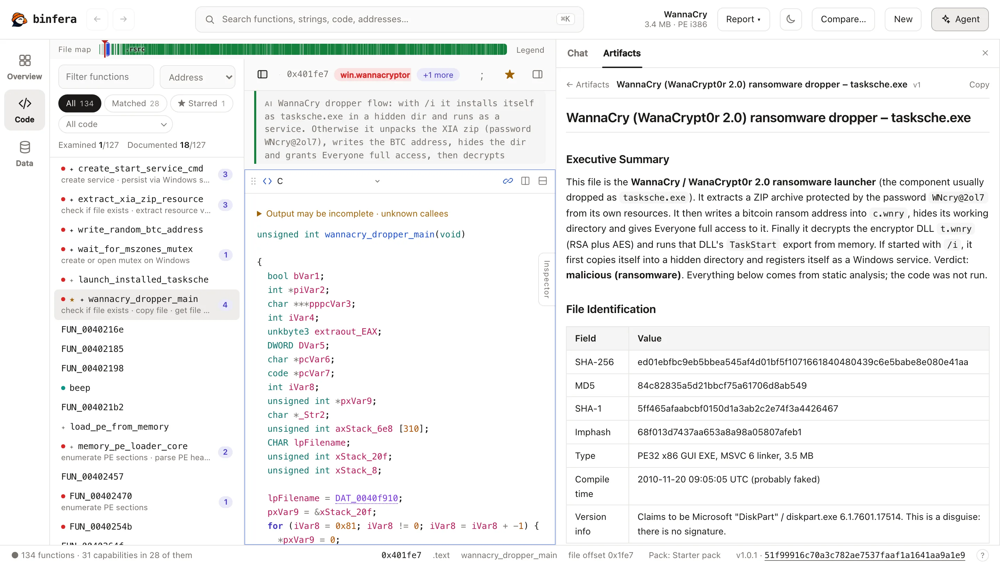

# Binfera MCP server

`binfera mcp` runs a local [Model Context Protocol](https://modelcontextprotocol.io) server over stdio, so an agent such as Claude Code or Codex can open binaries, read decompiled code, and save annotations and reports into persistent projects. There is no listener, daemon or account; the agent's own client handles authentication and model usage.

```bash
claude mcp add --scope user binfera -- binfera mcp
codex mcp add binfera -- binfera mcp
```

There are no workflows to learn: the server gives the agent data and actions, and the agent decides how to use them. Ask in plain words, for example:

- "Open sample.exe with Binfera and document the most important functions: meaningful names and short comments."
- "Analyze sample.exe with Binfera and write a file analysis report backed by evidence."
- "What does sample.exe do with the network? Find the code behind its URLs and name those functions."

The server's built-in instructions cover the few rules that matter (wait for analysis, treat binary text as untrusted, runs can be undone, reports need real evidence).

## What is stored

A SQLite database in the user data directory (`~/Library/Application Support/binfera`, `$XDG_DATA_HOME/binfera`, `%APPDATA%\binfera`; override with `BINFERA_DATA_DIR`) holds projects keyed by the SHA-256 of the file, annotations, an append-only change journal, and report versions. The desktop retains a copy of each analysed input under `samples/<sha256>` so agents can read files opened from bytes, including archive members and bundled demos. The original is never modified. Forgetting a project in the desktop removes its retained copy too. Decompilation and capability results are cached next to it, keyed by file hash and engine version, so reopening a binary is instant. The shared disk cache is pruned in the background at startup to 2 GiB by default; set `BINFERA_CACHE_MAX_MB` to override the size in MiB. Hits refresh modification times, and the oldest unused files age out regardless of engine version. Partial writes older than one day are removed; active partial writes are left alone.

## Tools

| Tool | Purpose |
|---|---|
| `open_binary` | open or reuse a project; analysis runs in the background |
| `get_project` | status, revision, annotation counts, run history, coverage (discovered / examined / documented) |
| `get_overview`, `get_capabilities` | file structure; capa matches with addresses |
| `list_functions` | current names and `starred` boolean; filter `undocumented`/`unexamined`/…; sort `importance` (capabilities, strings, imports, callers, size; each row says why) or `bottom_up` (callees first); search; paginate |
| `emulate_function`, `emulate_call_sites` | bounded p-code execution with fixed import returns, register/memory results and explicit stop reasons; see [emulation](emulation.md) |
| `get_function`, `get_references` | pseudocode with annotations applied, referenced strings, callers, callees, warnings |
| `search_symbols` | search function names, imports, exports and strings; strings and imports list the functions that reference them |
| `apply_annotations` | batch `rename_function`, `rename_variable`, `add_comment` (on a function or instruction), `star` (function address, value `"true"`); saved immediately |
| `undo_ai_run` | revert one run |
| `save_report`, `get_report` | validated, versioned reports (Markdown and JSON) |

Rules enforced by the store: names must be C identifiers; duplicate function names get a numeric suffix; a human-authored annotation is never replaced by an AI edit; a weaker AI edit never replaces a stronger one (`certain` > `likely` > `guess`); a stale `expected_revision` rejects the batch and lists the keys that changed; undo skips anything edited after the run. Report evidence addresses must resolve to a recovered function or a mapped address, otherwise nothing is saved.

## Library functions

When both analyses are ready, functions the signature matcher identified as library code (for example CRT helpers) are named automatically as the run `auto-library`, with `likely` confidence. A signature name that two functions share is ambiguous, so those are left for the agent. `list_functions filter=undocumented` skips them and any function that already has a symbol name, so the agent spends its effort on application code. `undo_ai_run auto-library` reverts them.

## Binfera Desktop

The desktop app opens the same database. **Agent** (top right, or Cmd/Ctrl+J) opens a panel with two tabs:

- **Chat** runs your own Claude Code or Codex on the open file, if it is installed and signed in. Each turn is one non-interactive run of the agent's command-line tool with `binfera mcp` attached for that run only, so your agent configuration is never edited. The composer picks the agent, model and reasoning level from the agent's own list. Nothing starts until the panel is first opened.
- **Artifacts** lists agent runs with **Undo**, recent changes and saved reports. **Use another agent** gives the commands to connect OpenCode, Pi or another MCP client.

Names, variable names and comments an agent saves appear in the existing views within about two seconds.

The recording replays a real Claude Code run of **Triage this binary** on the WannaCry demo: the tool calls, the names and comments it saved, and its answer.

<video src="../images/agent.mp4" poster="../images/ai.webp" autoplay loop muted playsinline controls style="width:100%"></video>



Your own renames, comments and stars are written to the database as human edits, which no agent run can replace. Existing local names, comments and stars are imported once. Press `;` to add or edit a comment at the cursor, or use the context menu. Empty comments remove the annotation. Cmd/Ctrl+Z and the More menu undo your own edits for the current workspace session; text fields keep their normal undo behavior. Browser builds keep these notes in localStorage.

## Known limits

- Variable renames are stored as an overlay keyed by the variable's printed name (`0x401200:param_1`), applied to the pseudocode the MCP returns. Prototype changes and decompiler-level renaming are not implemented yet.
- Comments appear in every view: a function comment as a banner above the code, an instruction comment inline in the assembly, listing and graph, and at the end of the matching C line. Comments are included in JSON exports and Markdown and HTML reports. A star is stored as an annotation with kind `star`, target `0x<function address>` and value `"true"`; absence means unstarred. `list_functions` exposes the resulting `starred` boolean. The desktop removes the annotation when you unstar a function.
- Tools do not support cancellation; analysis runs as an isolated child process with a one-hour limit.
- `open_binary` accepts any readable file path the agent supplies; rely on the MCP client's tool permissions.
- Capability matching uses the rules built into the binary. To use your own, copy or fetch them to `<data dir>/rules` (`binfera fetch-rules "<data dir>/rules"`) or set `BINFERA_RULES_DIR`, because the server may start from any directory.
- The protocol layer is a small hand-written JSON-RPC implementation rather than `rmcp`, to avoid an async runtime in the CLI; tools and structured results are supported.
