# Tour

What Binfera looks like on a real sample. Every picture on this page is the WannaCry demo from the [landing page](https://binfera.io), so you can open it and follow along in your own browser.

<video src="../images/tour.mp4" poster="../images/overview.webp" autoplay loop muted playsinline controls style="width:100%"></video>

## The overview

Opening a file lands here: what it is, a first look at how it was built and packed, a map of the file, and every capability grouped by ATT&CK tactic. Findings flag what deserves a second look, such as WannaCry's 3.3 MB resource with an entropy of 8.0.

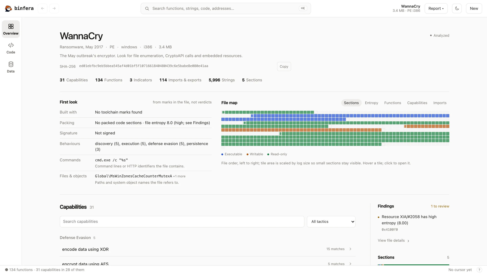

## Capabilities on the code

Each capability carries its ATT&CK and MBC ids and lists the functions that implement it. One click opens that function.

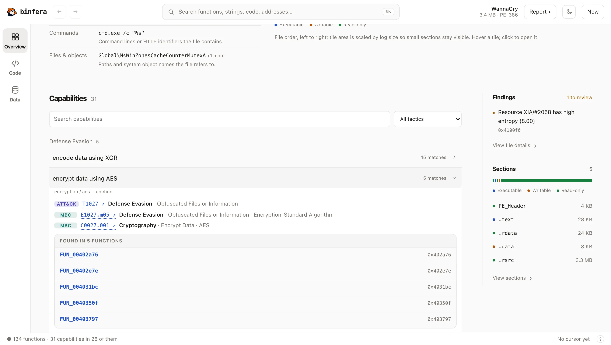

## Decompiled C, assembly and the graph

A function opens as decompiled C next to its control-flow graph, with the capabilities it matches above. Panes can show C, assembly, a listing, the graph, the call graph, hex, strings or imports, side by side or stacked. Both themes are built in.

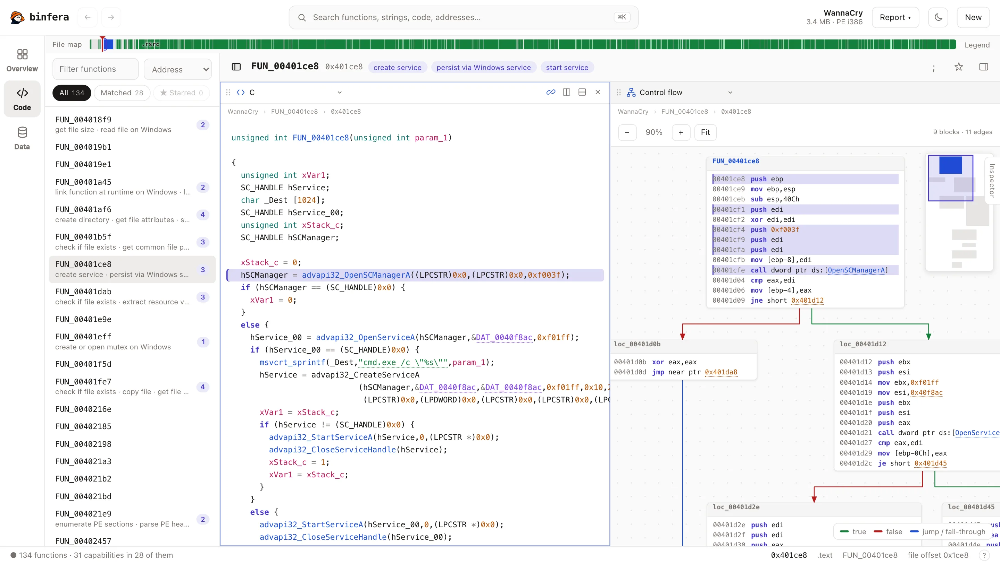

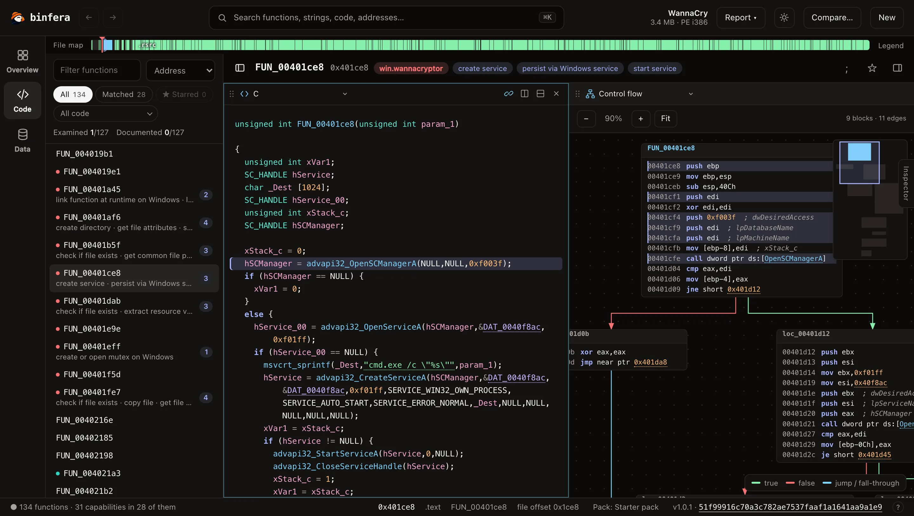

## Who calls what

The call graph shows a function's callers and callees two levels out, with the capability count of each, so the interesting branches stand out.

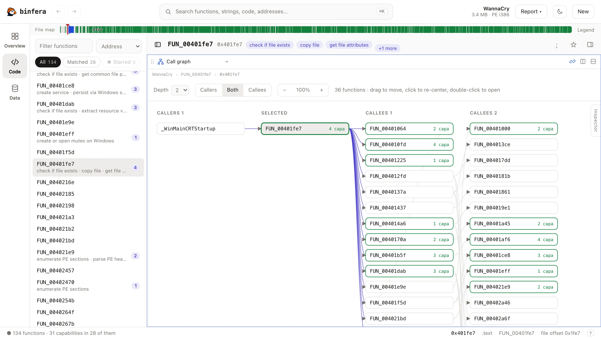

## Code and bytes together

The hex view sits beside the code that reads the bytes. Here the function that loads the `XIA` resource is next to the ZIP archive it extracts, starting with `PK`.

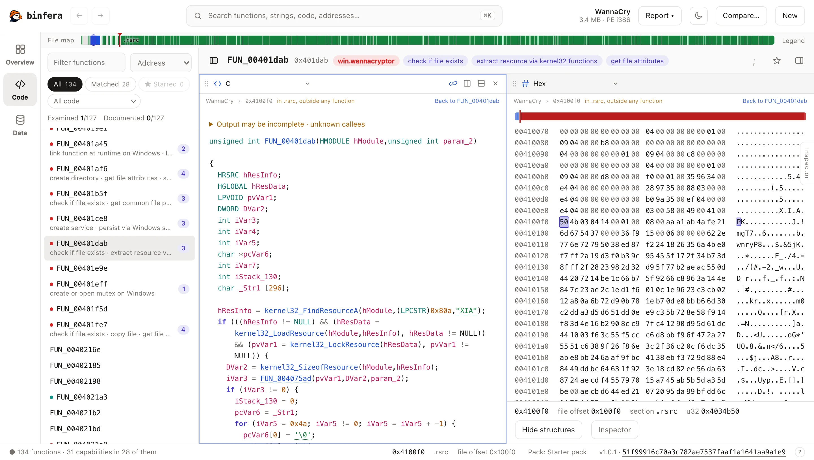

## Search everything at once

`Cmd+K` (`Ctrl+K` on Windows and Linux) searches functions, capabilities, imports, strings, decompiled code, assembly and references in one list.

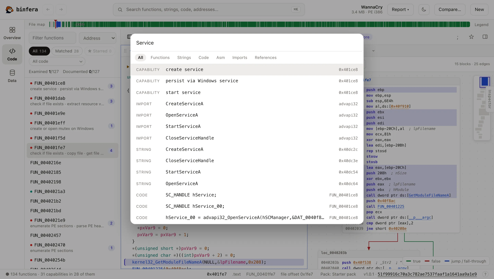

## Strings, imports and the file itself

The **Data** views list strings with the functions that use them, imports with their callers, and the file's headers, security flags and hashes.

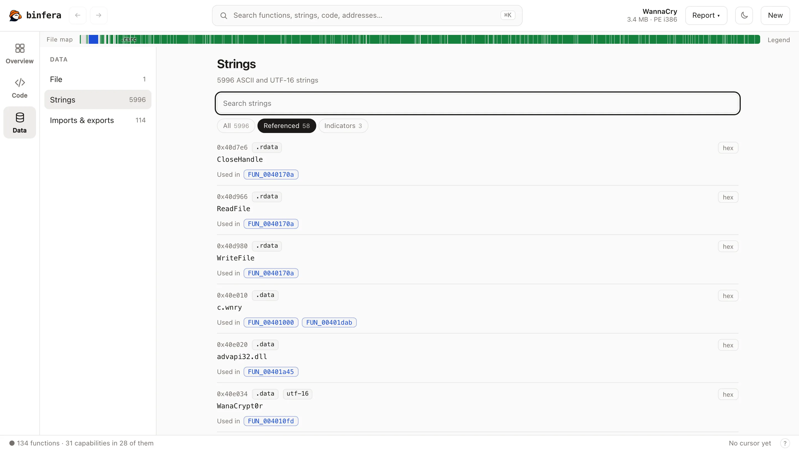

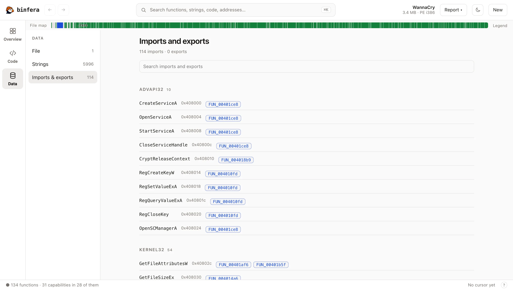

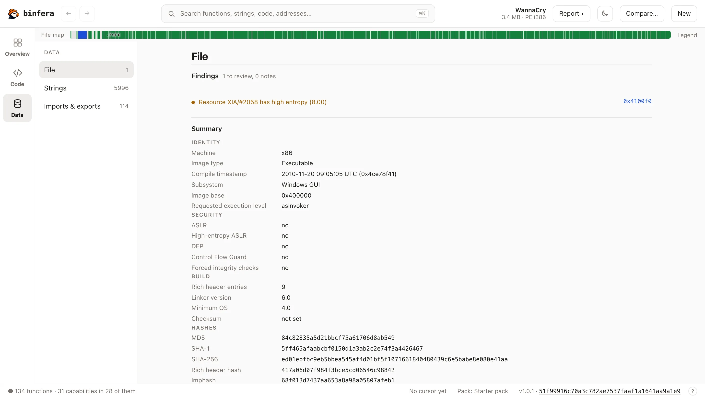

## Archives

Samples usually arrive zipped. Binfera opens zip and 7z archives in the page, tries the customary passwords such as `infected`, and lets you pick the member to analyze.

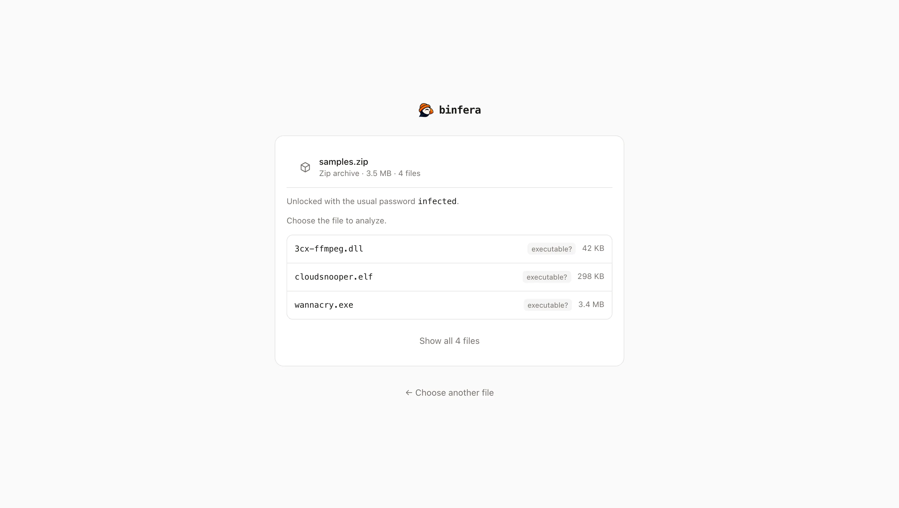

## Compare two builds

Two files give one sentence on what changed, then every difference ranked by what matters most, each down to the changed lines. See [Comparing binaries](comparison.md).

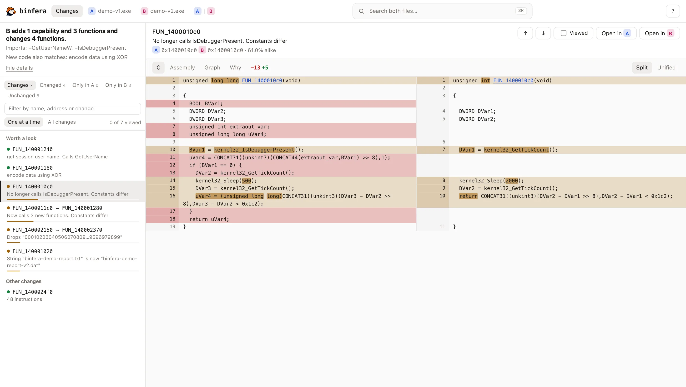

## Your own AI agent

In the desktop app, **Agent** runs your own Claude Code or Codex on the open file through Binfera's tools. The recording below replays a real Claude Code triage of the same sample: it reads the overview and the key functions, names and comments them, and answers with addresses you can click. See [Connect an AI agent](mcp.md).

<video src="../images/agent.mp4" poster="../images/ai.webp" autoplay loop muted playsinline controls style="width:100%"></video>

Reports the agent saves open in **Artifacts**, next to every run's names and comments, each run with **Undo**.

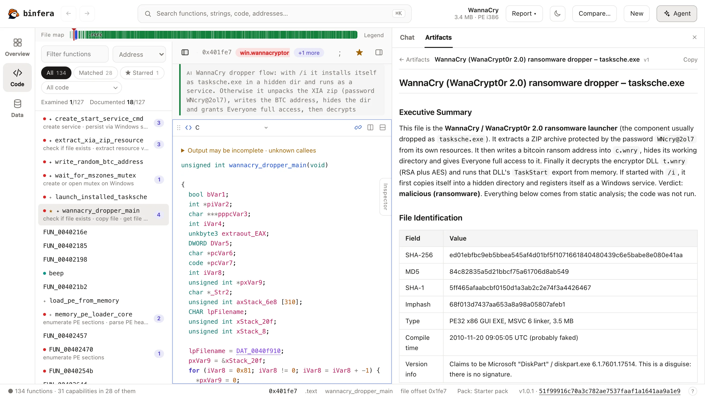

## The command line

The same engine as one command-line tool: the capability report, any function as C, or every function as one JSON object per line for scripts. `binfera diff` compares two builds in CI. See [Command line](cli.md).

